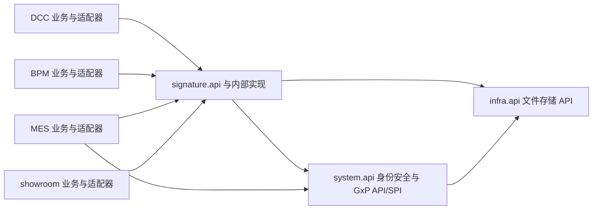
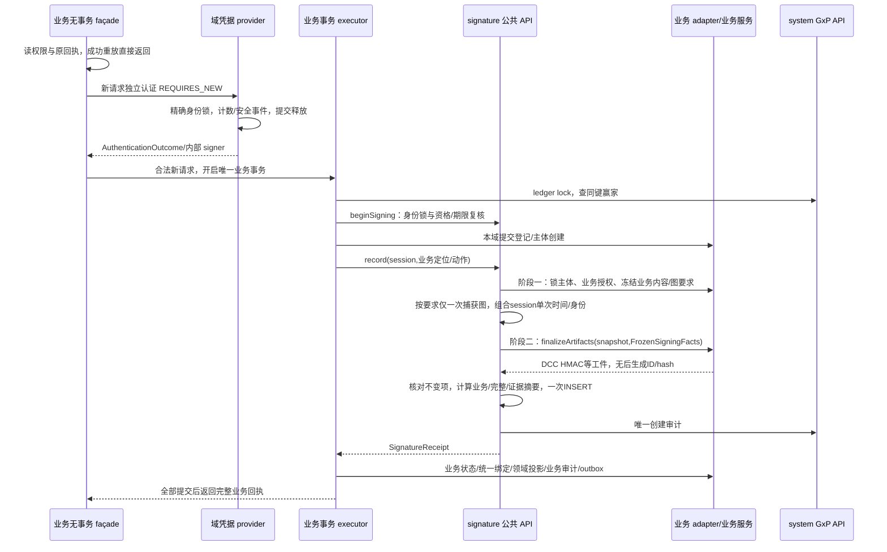

# 电子签名长期架构：模块化单体、独立领域与业务适配器

状态：APPROVED_DESIGN。日期：2026-10-10。主 Agent 完成两轮内容审查，§12 五项要求全部通过，见[审查记录](electronic-signature-architecture-review.md)。本文件作为后续实施合同；本次交付仅为文档设计与审查，没有修改 Java、Vue、SQL、配置，没有运行服务、数据库写入、业务测试、E2E 或发布。

## 1. 结果、边界与既有修复合同

业务用户继续在 DCC 审批、审批中心、生产提交、PQC、偏差等既有业务页面完成签署。业务判断当前对象是否允许签、实际员工是否有该动作资格、权威内容是什么；公共电子签名领域统一签名资格、重新认证编排、事实规范化、时间、图片快照、证据、幂等和验真。签署失败不推进业务；业务失败不留下正式成功签名。图片只是一项签署证据，不是电子签名本身。

保留 eDHR 以活跃订单为主的生产组长→一线生产→一线 PQC→双 100% 完工→PQC 生产放行→上市放行链路；批执行仅承载下游批记录和证据关联。稳定签名主体不等于要求所有生产提交必须有活跃订单、工单或批执行。用户确认的无这些背景的合法正式生产提交继续可签；已有入口本身要求的业务条件也不得因公共签名改造而放宽。“工序开始”、逐工序正式批记录绑定、`formBindings` 三链独立，签名适配器不得互相补齐。

衔接已批准修复：`doc/tasks/20261006-electronic-signature-repair-design-review/repair-plan.md:3` 是 APPROVED_DESIGN/M5，实施尚未执行；该文件 `:165`、`:175`、`:204`、`:245`、`:295` 分别定义成功重放、身份锁、上游事务拆分、V2 格式、消费协议。本文保留 SIG-01..07 和 R10：六个正文元数据、28 键 evidence、14 键 command、V1/V2 创建来源登记、临时档案凭据生命周期、旧 MES 17 段主体及 `sha256(subjectId)`、DCC 领域 ID/HMAC、既有带图 PDF 合同。本文的稳定主体合同另属**拟新增 V3**，不改名、扩充或重写 V2，不提前替换旧 reader，不将新 BPM 治理来源混入已批准修复范围。

ADR-0003 `docs/adr/ADR-0003-unified-electronic-signature-kernel.md:48` 的统一内核方向保留；其“所有临时人员必须转系统账户”的条款与当前用户确认及 M5 合同冲突，由 ADR-0004 明确替代身份强制归并部分，保留两域实名身份及各自动作资格。可信外部时间、HSM、WORM 和真正 MFA 不由本设计假称已实现；现有本地 SHA-256/服务器时间/创建审计核验边界保留。

## 2. 已核实现状：入口到下游

以下都是静态源码依据，路径相对仓库根。它们证明当前调用关系，不证明运行成功或目标已实现。

|业务节点|当前入口、服务、落库及下游依据|目标差距|
|---|---|---|
|公共内核|`IntRuoyiBackend/yudao-module-signature/pom.xml:19` 业务模块依赖只有 system，另有 framework starters；`IntRuoyiBackend/yudao-module-signature/src/main/java/cn/iocoder/yudao/module/signature/service/ElectronicSignatureServiceImpl.java:18` 引入 AdminUserApi 与 system.service.gxpaudit；`:58` / `:65` 是事务入口；`:77` 先锁 ledger，`:102` 档案 Runnable 认证，`:163` 写记录，`:164` 写创建审计|已独立 Maven 模块，但审计越过 public API；认证仍在业务事务中；Runnable 不是稳定凭据 provider 合同|
|DCC 审批|`IntRuoyiBackend/yudao-module-dcc/src/main/java/cn/iocoder/yudao/module/dcc/controller/admin/file/DccControlledFileController.java:688` / `:690` 保留审批入口及权限；`IntRuoyiBackend/yudao-module-dcc/src/main/java/cn/iocoder/yudao/module/dcc/service/file/DccControlledFileWorkflowServiceImpl.java:1111` 校验任务，`:1117` readiness，`:1124` 签署，`:1134` BPM 推进；`IntRuoyiBackend/yudao-module-dcc/src/main/java/cn/iocoder/yudao/module/dcc/service/file/DccSignatureVerificationServiceImpl.java:70` 授权、`:75` 取图、`:76` 建 DCC evidence、`:108` 统一签署、`:119` 写领域投影、`:191` insert|业务授权确实在 workflow；adapter 不能把这些责任仅换名字后忽略。DCC 投影独立 ID/HMAC 必须保留历史语义；缺显式统一关联须新增真实绑定，不能假定已经存在|
|BPM 审批中心|`IntRuoyiFronted/src/views/approval-center/index.vue:379` 密码输入、`:1110` submitReview；`IntRuoyiBackend/yudao-module-bpm/src/main/java/cn/iocoder/yudao/module/bpm/controller/admin/approval/ApprovalCenterController.java:58` / `:60` 业务入口及权限；`IntRuoyiBackend/yudao-module-bpm/src/main/java/cn/iocoder/yudao/module/bpm/approval/service/ApprovalCenterServiceImpl.java:126` 外层事务、`:150` 先签、`:158` provider.review；`IntRuoyiBackend/yudao-module-bpm/src/main/java/cn/iocoder/yudao/module/bpm/approval/service/signature/ApprovalSignatureRecordServiceImpl.java:55` 统一写、`:68` / `:69` 返回统一 ID|当前正式服务没有写旧 bpm_approval_signature_record；不能以新增旧表字段冒充新投影。provider 失败应回滚已写签名，拆 façade 必须覆盖外层调用者|
|正式生产与实际员工|`IntRuoyiFronted/src/views/mes/pro/feedback/FrontlineFixedTemplatePanel.vue:5112` 生产提交、`:5614` / `:5615` 发送实际员工及身份域；`IntRuoyiBackend/yudao-module-mes/src/main/java/cn/iocoder/yudao/module/mes/controller/admin/pro/feedback/MesProFeedbackController.java:114` / `:116` 入口权限；`IntRuoyiBackend/yudao-module-mes/src/main/java/cn/iocoder/yudao/module/mes/service/pro/feedback/frontline/MesProFrontlineFeedbackSubmitServiceImpl.java:105` 外层事务、`:165` 员工授权、`:173` 签署、`:186` 创建 feedback、`:199` 创建 event、`:208` 业务审计、`:209` handoff|当前活跃订单入口先签后生成 event；稳定主体必须调整生成顺序，而不能将内容或订单塞进主体 ID。该入口本身的订单检查不等于签名内核可以对所有生产入口强加订单|
|MES 凭据|`IntRuoyiBackend/yudao-module-mes/src/main/java/cn/iocoder/yudao/module/mes/service/pro/batchrecord/MesProBatchRecordExecutionSignatureService.java:9` 依赖 DCC 授权、`:263` 系统预认证、`:826` 编码主体、`:849` selected system 身份、`:868` / `:875` 档案密码与启用校验、`:896` / `:908` 档案回调|系统账户与 MES_EMPLOYEE_PROFILE 是两域；设备 operator 与实际 signer 分离，不能改为所有人必须当前登录账户|
|PQC|`IntRuoyiBackend/yudao-module-mes/src/main/java/cn/iocoder/yudao/module/mes/service/pro/frontline/MesFrontlinePqcContextServiceImpl.java:1335` 事务入口、`:1349` 预认证、`:1378` 签署、`:1411` 保存统一关联、`:1476` 业务审计|重复认证与已持锁外层要一起拆；放行上游同样纳入 M5 R3，不只改内核 propagation|
|adapter 现状|`IntRuoyiBackend/yudao-module-dcc/src/main/java/cn/iocoder/yudao/module/dcc/service/file/DccControlledFileSignatureSubjectAdapter.java:89` 解 12 段；`IntRuoyiBackend/yudao-module-mes/src/main/java/cn/iocoder/yudao/module/mes/service/pro/batchrecord/MesBatchRecordSignatureSubjectAdapter.java:65` 解主体生成 JSON、`:93` 将内容/动作/挑战编码、`:109` 哈希作版本；`IntRuoyiBackend/yudao-module-bpm/src/main/java/cn/iocoder/yudao/module/bpm/approval/service/signature/BpmApprovalSignatureSubjectAdapter.java:36` 解主体、`:54` 编码含图片 hash|当前 adapter 主要解码上游已构造值，并没有独立证明完整业务授权。不能称仅注册 adapter 即实现权威取数|
|偏差/NCR 消费|`IntRuoyiBackend/yudao-module-mes/src/main/java/cn/iocoder/yudao/module/mes/service/pro/batchrecord/MesProEdhrDeviationHandlingServiceImpl.java:14` / `:290` 直接 Mapper 查询；`IntRuoyiBackend/yudao-module-mes/src/main/java/cn/iocoder/yudao/module/mes/service/pro/batchrecord/MesProEdhrNonconformanceReviewServiceImpl.java:8` / `:663` / `:911` 直接读记录；`IntRuoyiBackend/yudao-module-mes/src/main/resources/mapper/pro/processpool/MesProProcessPoolTimelineReadMapper.xml:345` / `:354` 查询统一表并解析 signatureIdentity JSON|下游必须迁到 public typed query/binding verification，不能继续知晓内核表、Mapper 或内部 JSON|
|治理列表|`IntRuoyiBackend/yudao-module-dcc/src/main/resources/mapper/signature/governance/SignatureGovernanceRecordMapper.xml:80` / `:124` / `:165` / `:238` UNION DCC/MES/showroom/BPM 旧来源；第二组 detail 分支 `:359` / `:403` / `:444` / `:517`|当前列表是领域投影聚合，并不是覆盖全部正式事实的统一账本；新增 BPM 统一写可能不在旧 UNION|
|公共图片与失败安全|`IntRuoyiBackend/yudao-module-dcc/src/main/java/cn/iocoder/yudao/module/dcc/service/file/DccApprovalSignatureImageSnapshotProvider.java:8` 实现 BPM provider、`:17` 调 DCC 图片；`IntRuoyiBackend/yudao-module-dcc/src/main/java/cn/iocoder/yudao/module/dcc/service/file/DccElectronicSignatureFailureAuditServiceImpl.java:40` REQUIRES_NEW，`:42` 读策略、`:46` 授权、`:80` 更新锁态|图片与授权仍属 DCC；有 REQUIRES_NEW 不足以证明外层锁安全或并发计数正确，目标必须消除锁反序|

## 3. 目标模块边界与所有权

继续一个 Spring Boot 进程、同一租户数据源及事务管理器。模块拆分是职责和源码边界，不引入远程签名服务或分布式事务。以下箭头为**源码依赖目标**；API/SPI 指包级合同，当前不要求新建一组 api/biz Maven 子模块。

当前 signature 只依赖 system 与 framework。目标为文件访问显式依赖 infra 的公共文件 API；system 已依赖 infra，不形成反向边。signature 不编译依赖 DCC/MES/BPM/showroom；system 不依赖 signature；system GxP DTO/API 移入 system.api.gxpaudit，实现仍 system 所有。禁止 signature import system.service/dal；禁止业务 import signature.service/dal。MES 因其他业务仍需 DCC 的现存模块依赖不在此设计删除范围，但电子签名链不得再 import DCC 授权/图片服务。

**运行时调用**不同于源码箭头：signature 调自己定义的 subject adapter SPI，执行的是 DCC/MES/BPM bean；signature 调 system.api 定义的 CredentialProvider SPI，执行的是 system 或 MES bean。由 server Spring 装配，不需要内核反向 import 业务模块。provider 注册缺失/重复或动作重复注册启动失败，禁止按“找不到就系统账户/旧 DCC”切换。

|职责|权威所有者|合同与禁止事项|
|---|---|---|
|能否进行业务动作、任务/岗位/状态/数量、实际员工与设备范围|对应业务模块|既有 Controller 权限加领域 service 校验；adapter 调真实校验函数，不只拼 JSON|
|主体稳定身份、版本、业务内容/差异、动作图片是否必需|对应业务模块|adapter 从锁定的权威记录和本次合法命令生成；内容、当前版本不能信任浏览器|
|通用签名授权、策略版本、资格撤销/锁定管理|signature|`SignatureAuthorizationApi` 与公共管理入口；不是 DCC 审批权限，也不替代 MES 组长范围|
|身份安全凭据及失败事件|SYSTEM_USER 属 system；MES_EMPLOYEE_PROFILE 属 MES|system.api 纯策略与 provider 合同；同数字 ID 不能跨域，密码/hash 不进入 evidence|
|规范化、正式时间、签署事实、幂等、验真、图片版本管理|signature|统一正式不可变事实源；图片文件由 infra 存储，领域控制快照与引用保留|
|业务状态、绑定及业务审计|业务事务 executor|共享同一事务；投影只引用统一 signatureId，不能当第二个签署权威|
|创建审计/ledger|system|单向公共 GxP API；成功签名、业务审计同事务，安全失败事件独立事务不拿 ledger|
|治理记录检索、核验索引与导出编排|signature 的治理读侧|业务提供路由/权限描述与业务显示字段，公共层不能拼 DCC/MES 路径猜权限|
|业务通知/外部副作用|业务模块|本地 outbox 同事务；提交后可靠异步投递，不能在签署事务直接发送后冒称原子|

## 4. 拟新增公共内部合同

下列名称均为**拟新增/拟调整**，不是当前现成接口。只用于 Java 模块调用，浏览器没有通用 `sign(subjectType,subjectId,signerId,hash)` 写入口。现有业务 HTTP 入参可含明确的实际员工选择、expectedVersion、requestKey、密码和业务输入；tenant/operator 从服务端取，选择是否合法由业务解析。expectedVersion 是并发断言，客户端 hash 不作为权威内容。

包级所有权明确：`system.api.signaturecredential` 所有 `SignerKey`、`CredentialAttempt`、`AuthenticationOutcome`、`AuthenticatedSigner`、`LockedSigner`、`SignatureCredentialProvider` 和纯凭据策略；这些类型只使用自身DTO及基础Java类型，不引用signature DTO。provider的domain/tenant/id/operator/requestKey等身份及认证字段也不依赖业务subject。`signature.api`/`signature.api.dto` 所有 `SigningRequestContext`、`SigningSession`、`SubjectLocator`、adapter快照、`FrozenSigningFacts`、工件、receipt、typed evidence、ExpectedBinding、公共授权/图片/治理DTO；它们可以引用system的SignerKey，反向禁止。`system.api.gxpaudit` 所有 `GxpAuditExpectation`、创建事件/状态/关系DTO、`GxpAuditApi`及source registry，signature将自身事实显式转换成其基础字段，system不能引用signature的SubjectRef/Receipt/协议codec。

|接口/DTO|确定合同|
|---|---|
|`SigningRequestContext`|tenantId/operatorId/requestKey 从安全上下文及业务请求组装；包含服务端解析的 `SignerKey(domain,id)`、业务 entryCode；requestKey 为每次逻辑提交 UUID，网络重试保持，下一次提交换键|
|`SignatureCredentialProvider`（system.api SPI）|`domain()`；`authenticate(CredentialAttempt): AuthenticationOutcome`；`lockAndCheck(AuthenticatedSigner, signingInstant): LockedSigner`。前者独立事务，后者 MANDATORY 参与业务事务；凭据失败 outcome 提交后才由 façade 抛异常。SYSTEM_USER、MES_EMPLOYEE_PROFILE 各一个 provider|
|`AuthenticatedSigner`|内部不可由 HTTP 构造/序列化；tenant/domain/signer/operator/credentialGeneration/version/authMethod/requestKey；仅本次请求使用，不是浏览器 bearer token；新请求不得复用；重置/禁用/到期由 executor 再查|
|`SignatureOperationApi.beginSigning`|MANDATORY，先取 GxP ledger，再调用精确域 provider 锁身份、复核凭据生命周期/锁期/期限/generation/version；随后由 signature 自有授权服务锁公共授权行并核验签名资格，得到仅绑定当前 Spring 事务的 `SigningSession`。provider 不访问 signature 授权表或服务。认证在此之前已提交，本方法不再校验密码、不写失败计数|
|`SigningSession`|不透明、不可由业务随意构造、跨事务或跨线程不可复用；锁内一次 Clock 采样正式 instant，Asia/Shanghai、秒精度；提供冻结 signer、公共授权版本、formalTime 给 adapter。无事务、失效 session、身份错配明确失败|
|`ElectronicSignatureSubjectAdapter.loadAndAuthorize`|第一阶段接收 `SubjectLocator(type,stableId,expectedVersion)`、动作/occurrenceId、合法业务命令及已锁身份/时间。业务实现锁正式对象，核对角色/任务/前置/实际员工、从 DB/正式文件构造 `AuthorizedSubjectSnapshot` 与 imageRequirement；expectedVersion 不等直接冲突。不在此阶段取图片或生成含图片/正式签名ID的工件|
|`AuthorizedSubjectSnapshot`|subjectType/stableId/subjectVersion、`BusinessContent(schemaId,data,before,after,diff)`、action/meaning/policyVersion、occurrenceId、nodePosition、imageRequirement、业务关联。第一阶段冻结业务内容，内核用公开业务canonical合同生成businessContentHash。快照只由已登记adapter回调产生，外部不能直接提交绕过授权|
|`FrozenSigningFacts` / `adapter.finalizeArtifacts(snapshot,facts)`|第二阶段：core按第一阶段requirement仅捕获一次图、校验并冻结ref，与session已单次采样的时间/锁内身份/公共授权版本组成facts；传只读snapshot+facts给同一adapter构造DCC HMAC等领域工件。返回`DomainArtifact(type,format,payload,hashAlgorithm,hash,keyVersion)`，不得修改快照/身份/主体/版本/动作/occurrence/图/时间；不得读取当前图另采样；不得包含尚未生成signatureId/evidenceHash/auditId。内核前后比对冻结事实及businessContentHash，不等即失败；没有工件的动作返回显式空集合|
|`SignatureOperationApi.record(session, BusinessSignCommand)`|MANDATORY：第一阶段adapter授权与内容→core捕获冻结图→第二阶段adapter finalize工件→core核对不变项并生成完整envelope/hashes→一次INSERT正式记录→append唯一创建审计。返回`SignatureReceipt(signatureId,subjectRef,action,occurrenceId,signer,signedAt,businessContentSchemaId,businessCanonicalizerId,businessContentHash,contentHash,evidenceHash,requestIntentHash,resolvedCommandHash,formats)`；生成顺序/摘要字段详§10，无第二次图/时间采样|
|`SignatureAuthorizationApi`|typed `getQualification(SignerKey,actionScope)`、`requireQualification` 和授权管理；只判断公共签名资格，不能发放业务审批权。授权变更取得 ledger→身份→授权行锁，影响 version，不能在身份锁后再取 ledger|
|`SignatureImageApi`|`captureCurrentSnapshot(SignerKey,requirement,session)` / `readFrozenSnapshot(SignatureImageRef)` / 管理版本。快照含 imageId/version/fileId/hash/contentType/size/state，签名时引用即冻结；历史读只能按 ref 取原文件|
|`SignatureEvidenceQueryApi`|`getEvidence(signatureId)` 返回 typed identity/subject/action/meaning/time/image/artifacts/audit/status及`businessContentSchemaId,businessCanonicalizerId,businessContentHash,businessHashOrigin,contentHash,evidenceHash,commandHash,requestIntentHash?,resolvedCommandHash?,formats`；V3 businessHashOrigin=STORED_V3，V1/V2派生规则如下，V1/V2的后两V3 hash返回null/NOT_APPLICABLE，保留原commandHash及其版本，不给旧值改名。`verifyBinding(ExpectedBinding)`先核验完整签署证据/时间/唯一创建审计再比较业务绑定；`findBindings(BindingFilter)`返回分页typed行。不返回DO/Mapper或内部envelope JSON；跨租户、无读取权限明确拒绝|
|`ExpectedBinding`|signatureId/tenant/subject/type/version/action/occurrence/signerDomain+id/operator、businessContentSchemaId/businessCanonicalizerId/**businessContentHash**/必需审计关系；可另带本域原receipt冻结的expectedContentHash作完整事实摘要相等断言，不能由adapter重算完整envelope。业务consumer匹配公开业务hash，不把它误称contentHash；业务核对发生在内核完整证据验证之后，不能strip元数据后假称完成完整验真|
|`SignatureLegacyEvidenceReader`|公共读 SPI 只处理明确 V1/V2 历史协议；输出上述 typed 事实及 `HistoricalBusinessEvidence`（业务 schema 的公开合同），领域 adapter 转本域 typed view。内部 envelope 的版本剥离/完整 hash 校验归内核，不泄漏内部键给应用 service；历史业务 payload 的固定解析归本域历史 codec，禁止当前状态回放|
|`GxpAuditApi`（system.api）|`acquireLedgerLock/append/verifySignatureCreation` 与公共 DTO，承接 M5 所选创建审计范围。system 不反调 signature/MES；version/source registry 是 system 纯登记合同，不 import 新 executor 类|

读接口的当前权限与历史真实性分离：允许读取的人仍要经过当前读取授权；历史真实性基于冻结事实，不要求原员工仍启用、原任务仍活跃、当前图片仍有效。业务 detail、偏差/NCR、timeline 通过 typed binding/query 获取身份与核验；V1/V2 reader 的既有严格业务正文、交易/manifest/event/岗位校验不得消失。历史缺少某项 typed 数据就报缺失，不猜同 ID 对应用户或返回默认成功。

两种内容摘要明确分离：`businessContentHash = SHA256(UTF8(canonical({schemaId,data,before,after,diff})))`，固定五键，可空before/after/diff写null，公开canonicalizerId=`SIGNATURE_BUSINESS_CANONICAL_V1`，对象key排序/数组保序/null/UTF8与既有canonicalizer一致，schema定义业务字段类型，不自动trim/转类型。adapter可从权威业务记录生成同一BusinessContent并通过公共`BusinessContentCanonicalizationApi`重算；该hash不含身份/时间/图片/统一ID/内部envelope。既有命名`contentHash`继续指完整签署正文/envelope摘要，必须由core生成和完整核验；两者不能互换。V3把businessContentHash连同公开schema/canonicalizerId存入完整envelope及typed receipt/绑定，受contentHash保护。

历史V1/V2不增写/重算任何旧摘要列：core先按M5原协议对原完整canonicalContentJson、原contentHash/evidenceHash、时间及创建审计完整核验，再以固定版本codec提取业务内容副本，由已登记本域历史schema构造上述五键BusinessContent，返回`businessHashOrigin=DERIVED_VERIFIED_LEGACY`。V1仅移出原协议明确的可选signatureIdentity；V2只按M5六元数据白名单移出；其余未知键不得删除，schema不接受即拒绝业务绑定。原before/after/diff按原记录冻结值纳入五键，缺失明确null，不回查当前业务；schema无法确定则`BUSINESS_SCHEMA_UNSUPPORTED`，不提供可绑定hash。派生hash只是已核验历史业务内容的公开比较值，不当作旧签署原本存有该hash；typed query仍返回原contentHash/evidenceHash。消费者先保留M5对全部事实和业务关系的严格核验，再匹配这个业务hash，不能剥离后的内容hash冒充完整记录验证。

## 5. 稳定主体、动作、版本与幂等

V3 身份为 `(tenantId, subjectType, stableSubjectId, subjectVersion)`。stableSubjectId 是业务对象永久主键/受约束复合定位键，内容、姓名、图片、动作、挑战、时间不编码进去。业务选择版本标识并持久化，版本不等于全内容 hash；完整内容另由 contentHash 保护。既有对象没有可用版本字段时在本域新增显式单调 `signature_subject_revision`，内容/签署相关状态变更必须递增并持同对象锁，不能从当前时间或哈希临时拼版本。

以下是**拟映射示例**，数字只是说明，不是已有数据。类型为拟登记的新类型，不改变历史类型值。

|业务对象|V3 subjectType / stableSubjectId|subjectVersion|多动作、多次发生|
|---|---|---|---|
|DCC 文件|DCC_CONTROLLED_FILE / 文件主键 `321`|锁内正式 revisionId + 本修订 signature_subject_revision，例如 `revision:901:r:7`；修订 ID 来自 DB|APPROVE/REJECT/分发各有 action；occurrenceId 使用真实 task/receipt ID，返工 task 不同；换图不改对象身份|
|BPM 任务|BPM_APPROVAL_TASK / `module:sourceTaskType:sourceTaskId` 的受约束编码，如 `MES:PQC_RELEASE:125`（不是内容 Base64）|provider 的任务实例修订，含真实实例 generation，避免任务 ID 复用|APPROVE/REJECT 分动作；并行任务各独立主体；重提新任务实例，拒绝沿用旧 occurrence|
|生产提交|MES_PRODUCTION_SUBMISSION / 正式生产提交记录主键 `7001`|初次 `1`；本次提交内容锁定，补正形成 `2`，原签署不修改|每次逻辑提交一个正式记录；同记录可提交/补正/确认，不同 action+occurrence；同一订单可有多个提交|
|PQC 检验|MES_PQC_INSPECTION / 本次正式检验/提交记录主键 `8201`（不是总任务 ID）|本域显式 revision `1`/`2`|一个 PQC task 分次检验各有记录；PQC_SUBMIT、补正、确认各有 occurrence。生产放行另用放行申请主键，不复用检验主体|
|偏差处理|MES_DEVIATION_HANDLING / 处理记录主键 `9101`|已批准处理 revision `3`；无现成 revision 则新增本域字段|PREPARE/VERIFY/QA/CLOSE/QUALITY 等动作、真实节点执行 ID 分 occurrence；内容变更新 revision，历史签署仍指旧 revision|

### 5.1 无订单/批执行的生产提交如何先取得 ID

采用**同事务先插正式提交记录、后签署、再推进状态**，不把订单当签名主键。新增 MES 本域 `MesProductionSubmission` 逻辑实体（表名拟 `mes_pro_production_submission`），用于每个正式生产提交的身份与冻结版本；不是电子签名表，也不是假成功回执。所有合法正式生产入口均由本域 submission writer 生成该记录，activeOrderId/workOrderId/batchExecutionId 是按入口业务适用性可空的关联，不作为签名必需条件。现有活跃订单入口仍验证自己的订单、路线、实际员工和材料资格。

事务 executor 在 ledger→身份锁后，插入本域幂等提交键登记，获得同事务提交记录 ID；写入权威生产数据及 revision=1，状态为未提交且仅在本事务内可见；adapter 从这条正式记录和已锁定业务数据取内容，以 ID 签署；随后创建/关联当前入口需要的 feedback、processPoolEvent 等实际业务记录，绑定统一 signatureId，追加业务审计、完成状态和 outbox。没有订单的合法入口只写它本来需要的关联，不造假订单/event/批执行。任何步骤失败整个事务回滚，提交记录、绑定、正式签名、创建/业务审计均为零；数据库序列/自增可能留空号，不是成功事实。

选择新 submission 实体而非强行要求现有 processPoolEvent：当前活跃订单流程确有 event，但无订单合法提交未必有 event；统一使用业务 submission 主键可以避免依赖可选上下文。它不承载替代生产事实的默认字段，业务正文仍由真实生产记录生成。本域唯一约束 `(tenant, entryCode, requestKey)`，映射到 submissionId；成功后保存原请求摘要及完整业务回执。API 返回正式 submissionId；网络重试同键回读原 ID；签署失败再试仍同键、事务重新分配 ID，不存在已提交映射就不是已成功；第二次独立提交换键取得不同 ID，即使内容完全相同也不能被内容哈希合并。

具体调整为新增本域 `insertUnsignedSubmission` 和 `completeSignedSubmission`（均 MANDATORY）；前者使用明确 MySQL 自增主键，插入后取得 generated key，影响行数或 key 缺失立即报错，不假设当前配置有 Snowflake/预分配 event ID。schema 允许本事务插入时 unifiedSignatureId 为空、状态 UNSIGNED，但 executor 成功返回前必须以已生成 receipt 更新为 SIGNED 并写完整回执；任一失败回滚，正常提交不得存在 UNSIGNED 行，所有正式读取只允许 SIGNED。只在同一事务内 adapter 可读取 UNSIGNED 权威内容，不能向其他接口暴露“待签成功”。签署内容排除后生成的 signatureId/evidenceHash/auditId，避免自引用；它们作为后续关系事实同事务绑定。当前 `MesProcessPoolSubmitEventServiceImpl.toCreateEventReq` 签名核验→createEvent 顺序继续保持在签署之后，不把现有 createSubmitEvent 提前造成循环。新增 submissionId 作为正式反馈/event 的显式本域关联，event 仍先核验 receipt 的 typed binding，再按现有路径创建；改变的是生产 façade/executor 的提交身份和 adapter 权威来源，不宣称已有 createEvent 可提前分配 ID。

### 5.2 V3 请求协议

正式键为 `(tenant, entryCode, requestKey)`，内核同时保持 `(tenant, idempotencyKey)` 唯一约束，idempotencyKey由上述服务端键确定生成。requestKey不等于subjectVersion，不从内容hash推导。V3区分两种摘要，不将生成ID混入重放输入：

- `RequestIntentHash`（存既有command_hash列，commandHashVersion=V3）：固定对象`{protocolVersion,tenantId,operatorId,signerDomain,signerId,entryCode,requestKey,intentLocator,expectedVersion,action,reason,businessInputSchemaId,businessInputHash}`。intentLocator只含本次入口要求的原始稳定业务定位键，如既有fileId/taskId、PQC taskId、偏差handlingId；生产新submissionId、新PQC检验记录ID、新节点执行ID等**所有后生成ID与occurrenceId一律不含**。若请求本来指向已存在任务/节点实例，它作为intentLocator明确字段参与，而不是后来从当前状态推导。businessInputHash只覆盖请求的公开业务input schema，密码/当前姓名/图片URL/时间/所有服务器生成字段排除；生产可选订单上下文按该入口input schema原样参与，不转通用必需。历史成功重放只按此原intent协议、当前读取权限和原回执核对，绝不新生成ID/occurrence或重新加载当前资料。
- `ResolvedSigningCommandHash`（拟新增resolved_command_hash列）：认证后executor已取得正式主体/版本/真实occurrence、adapter授权内容和冻结facts后生成，固定对象`{protocolVersion,requestIntentHash,moduleCode,subjectType,subjectId,subjectVersion,action,occurrenceId,meaningCode,policyVersion,businessContentSchemaId,businessCanonicalizerId,businessContentHash,signerKey,operatorId}`。全部值来自本次锁内解析；不含密码、图片、时间、未生成signatureId/evidenceHash/auditId。其目的为保护intent到已解析业务动作的映射，不是重新认证或重放输入。它进入完整envelope并随正式行一次INSERT，查询通过冻结字段重算，不能让客户端传任意resolved命令。

所有V3入口都使用同一“intent先于认证，resolved后于锁内解析”顺序；已有occurrence的DCC/BPM/偏差入口，请求task/node定位已在intentLocator中保护，core最终resolved occurrence必须与该定位的真实实例一致；生产/新PQC记录由同事务正式记录分配occurrence，原intentLocator没有生成字段。提交根和签名根同事务冻结两hash、分配ID、真实occurrence、signatureId与完整回执；失败回滚不留下已提交映射。V1/V2重放仍按M5原commandHashVersion协议，不套V3 intent字段或改旧hash。

同键同请求在当前读取权限内回读完整旧回执，零重新认证、零当前资料采样、零签署/业务写；同键不同员工/身份域/operator/业务输入/动作/版本拒绝。已成功后密码过期或员工停用不否定原事实。并发两次首次未命中可各留下真实认证事件，但 executor ledger 后重新检查同键，只一个完整提交。仅提交根/签名根准确幂等约束冲突可在**退出并回滚原事务后**新只读事务回读赢家并核对全部请求；投影、图片引用、审计等子记录冲突是失败，禁止吞异常。赢家缺绑定/业务回执即不返回部分成功。

同一主体同版本允许不同动作或经业务允许的多次发生；唯一业务动作约束由业务 `(subject,version,action,occurrenceId)` 控制，不以 `(subject,version)` 禁止所有第二个动作。occurrenceId 是业务锁下确定的真实任务/节点执行/提交实例 ID；客户端不能随意换 occurrence 绕过“已审批”。新逻辑提交与网络重试通过 requestKey 区分；业务不允许重复审批时即使换键也拒绝。

## 6. 同事务时序与失败语义

业务 façade 必须无外层事务/锁。实现采用入口的 `Propagation.NEVER` 检测误入事务，调用独立 Spring bean 的 executor，禁止 self-invocation。全部现有上游按 M5 R3 拆：生产提交、PQC 检验/生产放行、批记录字段补正、偏差/NCR、批次关闭/作废/跳节点、eDHR 放行、DCC workflow/分发/治理执行、BPM reviewTask/策略切换/businessapproval submit。上层已有事务的协调器必须把认证提升到最外层 façade，原业务回调仍在 executor 同一事务，不能仅在 kernel 开 REQUIRES_NEW 后保留上游已持有 ledger/业务锁。

同事务前提：同一 DataSource、PlatformTransactionManager，所有签名/绑定/审计/业务 callback 使用 REQUIRED 或 MANDATORY，禁止 REQUIRES_NEW 成功写；BPM/Flowable 引擎资源也必须参与这个管理器，实施阶段真实核查，若不同管理器即阻断该路径，不以补偿承诺代替本合同。正式 audit append 失败、provider.review 失败、实体 update=0、绑定缺失、图片引用失败均抛出并整事务回滚。提前 return、空值或异步创建审计不能满足。

锁序固定：ledger→精确身份行（tenant/domain/id）→公共授权行→业务主体（同域主键升序）→图片版本引用/绑定。正式业务 executor 取得签名 session 后才能锁业务对象。授权改变、密码/身份禁用且需 GxP 的管理入口同样 ledger→身份→授权/对象。独立认证只锁身份及本身份域安全事件/历史，不拿 ledger、不改公共授权；禁止外层锁身份后再开独立认证。图片管理不在图片行锁内取 ledger/身份，GxP 写入口先 ledger 再身份/图片。bulk 身份按 tenant/domain/id 排序。任何改密/禁用/授权写方未遵守此序不能放行正式新写。

独立认证采用 M5 已选两个事件域：拟 system_signature_authentication_event 与 mes_employee_profile_signature_authentication_event，计数和事件同独立事务提交；正确密码返回内部 generation/version，错误/锁定返回 outcome，独立事务提交后 façade 转 ServiceException。写安全事件失败中止认证并报告持久化错误，不进入业务事务。正确密码且 ACTIVE 才清计数；锁内失败不延锁；弱/复用新密码不清失败计数。签署锁内以当次秒时间重新判断 enabled/lifecycle/资格/lockedUntil/90 天期限及 generation/version；先重置提交则旧认证拒绝，先签署锁持有则重置等提交后生效。

M5 的 MySQL generation/version 防 ABA 与触发保护继续执行，不降为应用口头约定。system 与 MES 各自身份表及事件/密码历史隔离。临时 profile 不需要系统账号；正式用户公共授权从 DCC 所有权迁出，但不得降低现行资格；临时 profile 使用其本域启用、无 systemUserId、唯一组长归属与本人密码，迁移登记等价公共资格，不能从任意同 ID 系统授权推断。

|失败阶段|持久化/响应|
|---|---|
|读取原回执失败或无权限|真实服务错误/权限错误；不能转新签署绕开|
|业务预检/范围拒绝|无正式写，不尝试错误身份 provider|
|凭据错误/锁定/生命周期拒绝|本域安全事件和按规则计数持久；无正式签名/业务成功|
|认证提交后重置、失效、版本变化|executor 拒绝并回滚；先前真实认证事件保留，不重新认证自动重试|
|签名后业务/审计/绑定失败|整个业务事务零正式成功；认证事件独立保留|
|提交完成但 HTTP 超时|同键通过原协议及读取权限回读原完整成功，不新增事实|
|异步投递/读模型失败|已提交签署不撤销；任务状态 FAILED/RETRYING 可见，重试相同 eventId 幂等，不宣称通知已送达|

## 7. 正式事实、业务绑定与不可变性

新签署唯一事实源继续使用 signature 所有的正式记录（当前表名 system_electronic_signature 不代表归属 system；本轮不要求改名）。V3 新增明确 evidenceFormatVersion/commandHashVersion/subjectIdentityVersion/contentSchemaId；旧版本不改。正式签名只 INSERT，不 UPDATE/DELETE；撤销/替代/版本变更新增 lifecycle evidence，关联 originalSignatureId/newSignatureId、原因、操作人、时间、审计，查询当前有效状态由证据推导，原签名一直可验。撤销不“抹去曾签署”；是否允许业务撤销由对应业务动作决定。

业务统一保存 `unifiedSignatureId`（公共 API 的 signatureId），投影自身 `projectionId` 清楚分离。DCC 保留原 dcc signature projectionId/HMAC 和旧路由；它们是领域工件/历史入口，不再构成另一个正式签署内核。新增真实绑定由同事务 receipt 写入投影/本域绑定，不以 DCC projectionId 数值等于统一 ID 推断。MES event 中现有 signatureId 明确映射为 unifiedSignatureId，API 层命名明示；既有本域 projectionId 单独展示。BPM 新正式写仅统一事实+provider 业务回执绑定，不恢复旧 bpm_approval_signature_record 写入。

投影允许业务显示字段、节点/附件/领域 HMAC 工件索引及必要历史冻结数据；不能再独立认证、独立生成“成功签名”或改正式 signedAt/identity/contentHash。投影中重复元数据为可核对的缓存，读公共事实冲突时明确报告 PROJECTION_MISMATCH，不选择“较新的值”。正式导出及验真从公共事实和冻结领域工件读取。新正式签名与投影绑定在同事务不是长期双事实源双写；旧签名表切换后仅历史只读。

历史缺统一关联不补猜。当前 DCC 的 `persistSignatureEvidence` 虽接收 ElectronicSignatureResult，但没有使用它建立 FK；DO 没有 unifiedSignatureId，响应 signatureId 是 projection.id，这不是可直接搬迁的映射。新写必须原子保存 projection.id→unifiedSignatureId 的显式绑定。若存在可证明的原业务回执/创建审计明确记录统一 ID，可新增**关联证据**（迁移批次、原来源 ID、证据依据 hash、统一 ID、审核结果）而不修改旧签名正文/摘要；不能仅凭同 ID、姓名、时间近似、内容 hash、当前文件状态或查到一条候选建立关联。只读候选索引可供核查，零确证为 UNLINKED，多候选或证据冲突为 AMBIGUOUS，隔离并禁止当作完整关联验真；即使单候选也须确证规则通过。保留领域核验能力与历史链接，不造总体 VALID。

## 8. 授权和图片迁移归公共领域

公共资格授权与图片 registry/管理 Service/API/公共管理 Controller 从 DCC 迁 signature，复用现有菜单意图并在切换版本同步更新前端/Controller 权限、角色和租户套餐映射。业务仍保留 DCC 审批、MES 实际员工/组长、PQC/QA 岗位授权。旧 HTTP 管理写路径在本阶段切换后停止写，返回明确迁移错误，不转发失败到新旧服务；旧业务历史 DCC 详情/验签 URL 保留只读，因为它们仍是有效历史协议入口。

为减少损伤，授权/图片原表物理名和原 ID 可保留，所有权、Mapper、Service 迁至 signature；名称 dcc_ 是历史 schema 标记，不继续让 DCC 服务控制公共生命周期。目标公共 domain/id 关联需 additive 列/关联表，系统授权原行按真实 userId 迁 SYSTEM_USER；MES profile 资格仅按真实 profile/enabled/归属登记，不凭 system user ID 命中。新旧服务禁止同时成为这些表的写所有者；切换同一发布版本，权限和唯一写入口测试通过后关闭 DCC 写 bean/Controller 及 BPM 专属 provider。

现有 DCC 授权/图片 DO 继承 BaseDO，原行仅 userId、没有 tenantId；不能假称已有租户字段。迁移目标键固定 tenantId+identityDomain+identityId。原授权/图的 userId 必须与保留的原 SYSTEM_USER 主记录（包含逻辑删除行）唯一匹配且 tenant 明确，才登记该租户；主记录缺失时仅接受签署时明确记录 userId、tenant、原 imageId/version/hash 的历史证据，所有证据一致才能登记。主记录与历史证据冲突、跨租户重复引用、缺证据均隔离，不归 tenant0、不以当前登录租户代填。冻结原 imageId/version/fileId/hash 的迁移映射，不改历史原文；旧 ref 经公共历史映射读原版本。未能确定归属的旧资格/图片不能用于新签，但历史只读能力按证据范围保留。

原DCC authorization的failureCount/lastFailureAt/lockedUntil与行政停用分类搬迁：凭据错误计数/窗口/密码锁归本身份域provider，行政暂停/撤销归signature。**不采用max或求和猜测两来源计数。**切换窗口先停止该身份所有旧签署认证writer，按ledger→身份→授权锁冻结DCC和system各自原始计数/窗口时间/锁期/策略版本/原失败事件引用，记录独立迁移证据；随后只允许新provider为唯一认证writer。旧表不再计数，迁移证据只读。

可确定全部逐尝试事实时，使用持久化attemptId或明确的原事件关联去重，不能按时间相近、姓名、IP或数值相同认为同一次；无attempt关联但疑似重叠即不完整。对完整去重集合按新策略的固定滚动窗口`[cutoverAt-15分钟,cutoverAt]`重放失败，记录窗口起止和每个来源原eventId；5次达锁阈值。原锁期分别保留，资格要求重放结果及**每一个来源**未到期锁均已解除，不能通过合并缩短任何原lockedUntil。切换后的新失败只写新provider，计数基于已明确导入的逐尝试集合及新事件；正确密码按策略清新计数，但不得清未到期的原锁或行政锁。

任一当前有效来源窗口有计数却缺完整逐尝试证据，则该身份标`MIGRATION_CREDENTIAL_EVIDENCE_INCOMPLETE`，新签/认证直接拒绝，不能让独立3+3缩成3而放行。保留两来源窗口/锁状态分别生效，直到原窗口和原锁**按各自原策略精确截止**全部自然结束或审核取得完整证据后收口；这段拒绝是明确迁移状态，不调用旧writer或更弱provider。DCC原实现以lastFailureAt是否早于当前时刻减passwordFailureWindowMinutes判断连续失败有效性，不能捏造未存的windowStart；冻结lastFailureAt+原windowMinutes作为其到期判定。system按其真实原window字段/语义登记；字段/策略/截止时间缺失或冲突则不能自行设15分钟期限，持续隔离直到人工核实。自然结束仅结束可证明已过期的安全窗口，新provider记录迁移关闭事件后开始空的新窗口，原快照/计数不删除；任何原锁仍未到期继续拒绝。

公共资格的密码型锁只有在迁移事件确认凭据域完整接管且所有原窗口/锁已按上述规则解决后才解除该标记；行政锁不解除，未知锁原因保留`MIGRATION_LOCK_UNRESOLVED`。公共锁管理仍ledger→身份→授权；认证失败不写授权表，消除双writer。迁移状态的读取/收口在身份锁内核对，不取旧密码路径；此安全元数据可变，旧签署事实不可改。

图片署时固定 `(tenant,imageId,version,fileId,sha256,size,contentType,state)`，共享永久版本文件；URL 只是定位。使用 CAPTURED 的动作校验原文件内容与 hash 后写入正文并保留引用，原文件不能覆盖；更换/禁用图片仅影响未来签署。历史导出按被冻结 ref 读取原版本并再次校验，找不到/损坏明确失败，禁止当前图替换。动作允许无图则明示 NOT_REQUIRED（尤其既有临时工生产动作），不存在虚拟图，也不强加上传图前置。旧未采集为 LEGACY_MISSING，不能从当前头像/签名图补采。

M5 已批准带图 PDF 仍要求 CAPTURED；NOT_REQUIRED/历史缺图不自动输出另一种成功 PDF。未来文字证据 PDF 是独立产品合同，本设计不批准。公共图片 API 供 BPM/MES/DCC 直接调用，删除 DccApprovalSignatureImageSnapshotProvider 对 BPM 接口的归属倒置；图片 DTO 和公共 provider 接口由 signature.api 定义。

## 9. 跨模块治理列表、权限、分页与导出

新增 signature 所有的治理读模型；不是改写既有 DCC UNION 为“统一真相”。目录项保留两种身份：`sourceRef(sourceCode,sourceTable,sourceRecordId,legacyGlobalId)` 和 `unifiedSignatureId?`，以及 `recordKind=UNIFIED/LEGACY_ONLY`、`linkStatus=EXPLICIT/PROVEN_MIGRATION/UNLINKED/AMBIGUOUS`。统一事实存在时以 `SIG:<id>` 作为公共 recordKey；旧 globalId 是 alias。缺显式关联的领域历史以 `LEGACY:<sourceCode>:<id>` 成项，两者同数字不合并。已经明确绑定的多个领域投影归同一公共项，保留全部 sourceRef 与历史链接；无绑定不能凭 hash 去重。

治理 public query 的 DTO 明确 signerDomain/signerId、冻结姓名状态、operator、subject/type/version、action/meaning、signedAt/time source、图片状态、证据算法/范围、来源及业务路由 key；查询不逐行完整验签，显示 CAPTURED/NOT_VERIFIED 等维度。用户详情触发只读完整核验，返回 scope/verifiedAt/reasonCodes；接口异常清除本次成功状态。列表捕获或密码已验不能展示总体 VALID。

业务 `SignatureGovernanceSourceProvider` SPI（拟新增）提供**读取数据和 scope/route 描述**，不写正式签名。public list 先解析当前租户、菜单权限和岗位/业务数据范围；将服务端 `ReadScope`（source、部门/本人/组长/对象许可集合等）用于同一读模型 SQL 的 WHERE，COUNT 和分页都在过滤之后，禁止先分页后 Java 剔除。无法表达精确 scope 的来源不得开放该列表来源，返回范围合同错误而不是扩大权限。detail、verify、export 再向对应业务 read authorization SPI 核对真实对象；对象删除/归档需使用保留的历史 ACL/归档读取授权，不把“找不到当前对象”当所有人可读。

排序固定signedAt DESC、recordKey ASC；索引按tenant/source/subject/signer/action/time规划，pageSize上限200。采用**最终一致cursor分页**：服务器签名cursor只保存上一页末行的signedAt/recordKey与过滤条件hash/tenant，不冻结记录集合、不提供跨页MVCC承诺、不以aggregate sequence重建历史列表。每页在当前读模型/当前scope下过滤再取锚点之后的行，total是该次COUNT的totalAsOf，不宣称与前页总数恒等；读模型延迟、重建、关联归并期间集合可能变化，用户刷新开始新的遍历。modelWatermark仅表示消费者进度/asOf，不能当查询快照。每页/detail/verify/export重新核对当前权限，cursor不保存授权；客户端不能传自由SQL/table名/任意路由。

正式签名与 outbox 同事务，读模型采用至少一次事件消费+幂等 upsert（eventId 唯一），仅消费已提交事实。批量历史导入通过业务只读 provider、确定 sourceRef、迁移批次与水位构建；不修改旧表。新记录短暂未进入读模型时，list 响应 watermark/asOf 与 pending count，详情仍由业务回执 signatureId 正式读取；不得在读模型异常时运行 UNION 兜底、拼当前姓名、或返回空列表成功。读取不提供 read-your-write 的假承诺，签署成功页显示直接 receipt。

沿用当前 `signature-governance:policy:query` 权限，不因公共模块迁移放宽为任意已登录用户。个人列表只匹配服务端登录者的 tenant+SYSTEM_USER+loginUserId；设备账号个人列表只包含它自身 SYSTEM_USER 签署，不能把设备所选员工的事实自动当“我的签名”，MES_EMPLOYEE_PROFILE 不因此获得系统个人待办/目录权限。业务组长/治理岗位查看员工历史走其显式范围授权。

业务 routeKey/参数由业务 provider 注册，服务器 allowlist 生成 detailPath；历史 DCC route 保持 projectionId，公共核验用 unifiedSignatureId；旧 alias 能定位来源项，即使无统一关联也保持可见能力边界。新统一 BPM 签名即使没有旧表行，也从统一事件进入公共列表，provider 给真实 source/task key 与权限；该扩展在长期阶段，不属于 M5 修复。

导出不沿用列表cursor冒充整份快照：在导出开始的一次数据库一致读事务内，按本次过滤和当前scope取得确定recordKey集合，持久化本次export manifest与筛选/asOf，随后逐项重新核对当前权限及公共/历史只读核验；权限收回或必需项缺失使导出明确失败，不静默跳项。manifest含recordKey、两种身份、格式/范围/维度与导出时点，不把HMAC/挑战/字段审计hash混为统一SHA256。可见列表此前翻页与导出集合可能不同，产品须明确显示“按导出开始时符合筛选的记录”。正式带图证据PDF仍遵守第八节，不自动改文件类型。导出审计归公共治理（独立访问动作，不更新签名）。

可靠交付：拟本地 `signature_event_outbox` 持久 eventId/aggregateId/sequence/payloadVersion/status/attempts/nextAttemptAt/lastError；事务中 insert，提交后 worker claim，消费者按 eventId 去重且按 aggregate sequence 推进水位。退避 1 秒起指数增加，上限 5 分钟；10 次失败标 FAILED，告警并人工按原 eventId 重放；失败积压可查询，不删除丢失事件。投递后未 ack 可重复，无重复通知成功记录；通知本域同样需要 outbox/consumer 幂等。无可靠持久 outbox 就不得声称异步通知/目录同步完成。

## 10. 历史和混合代际验真

V1、M5 V2、拟 V3 是明确协议分派，不是“新核验失败改用旧算法”。版本缺省仅按 M5 定义的 NULL=V1 规则；未知非空版本/算法/创建来源返回 UNSUPPORTED/INCOMPLETE，矛盾为 MISMATCH，基础设施错误抛真实错误。V1/V2 的原字节/原 canonicalizer/冻结主体、创建 sourceLocator、严格身份 ID 类型及原审计匹配保持，不能调用当前 adapter 重建历史。V3 reader 上线前保留已通过的 V1/V2 reader，全部公共 query 返回统一 typed 维度。

V3沿用UTF-8/对象key排序/数组保序/null明示canonicalizer，标识`SIGNATURE_CANONICAL_V3`。完整签署envelope固定top-level：`evidenceFormatVersion,commandHashVersion,subjectIdentityVersion,canonicalizerId,moduleCode,subject,action,occurrenceId,meaning,identity,authenticationMethod,signatureTime,signatureImage,nodePosition,businessContent,businessCanonicalizerId,businessContentHash,domainArtifacts,policyVersion,requestIntent,requestIntentHash,resolvedCommandHash,lifecycleReferences,creationProtocol`。subject固定type/id/version；meaning固定code/label；identity固定domain/tenantId/signerId/operatorId/displayName；businessContent是§4公开五键对象；requestIntent是§5.2固定对象，不含后生成ID。domainArtifacts是第二阶段不可变工件数组，按type/format/hash确定排序；相同type/format重复拒绝。creationProtocol固定`{sourceType,sourceLocator,operationId,afterStateType,auditSchemaVersion}`。可空键明写null，未知键/类型拒绝。`contentHash=SHA256(UTF8(canonical(完整envelope)))`，包含全部身份/时间/图/请求/领域工件；绝不对剥离副本计算后声称完整通过。

`evidenceHash`采用固定`EvidenceHashInput`对象，完整字段清单为：`{evidenceFormatVersion,canonicalizerId,algorithm,contentHash,requestIntentHash,resolvedCommandHash,businessContentHash,tenantId,moduleCode,subject,action,occurrenceId,meaning,identity,authenticationMethod,signatureTime,policyVersion,creationProtocol}`。所有重复值必须与完整envelope及列逐项一致，algorithm固定SHA-256；`evidenceHash=SHA256(UTF8(canonical(EvidenceHashInput)))`。它通过contentHash保护图片、业务内容、domainArtifacts等完整正文；它不含自身、不含后生成signatureId/auditId/projectionId/eventId、不含当前创建事件hash，因此无循环、无需INSERT后UPDATE。lifecycleReferences只允许已存在的原签名ID，不能指尚未生成的本条ID；字段版本标识不是MAC密钥。

确定生成顺序：façade在认证前按§5.2生成requestIntentHash并核对重放；新请求认证后executor锁内第一阶段业务snapshot和businessContentHash→一次FrozenSigningFacts→第二阶段工件→resolvedCommandHash（引用原intentHash，不重新采样intent）→完整envelope/contentHash→EvidenceHashInput/evidenceHash→**一次INSERT**取得signatureId→以生成的signatureId与上述hash append唯一创建审计取得auditId→业务关联/回执/审计/outbox同事务。auditId不回写正式签名；创建审计公共读通过tenant+signatureId+精确operation查询且要求唯一，缺/重复/列与canonicalEvent/afterState矛盾失败。创建afterState固定包含signatureId、三格式版本、module/subject/action/occurrence、identity/signedAt、businessContentSchemaId/businessCanonicalizerId/businessContentHash、contentHash/evidenceHash、requestIntentHash/resolvedCommandHash及creationProtocol，与正式事实严格相等，使用既有schema2/canonicalEventHash/statePayloadHash和交易关系核验；后生成业务ID在本域绑定/业务审计manifest中保护，不反写签署正文。

V3创建登记明确新增`IntRuoyiBackend/yudao-module-signature/src/main/java/cn/iocoder/yudao/module/signature/service/ElectronicSignatureV3TransactionExecutor.java#executeAuthenticated`（拟新增，MANDATORY参与外层业务事务）。`sourceType=SERVICE_METHOD`，sourceLocator字符串精确`ElectronicSignatureV3TransactionExecutor.executeAuthenticated`，operationId=`signature.record.create`，afterStateType=`ELECTRONIC_SIGNATURE_RECORDED`，auditSchemaVersion=2。system.api.gxpaudit的纯SignatureCreationProtocolRegistry登记`evidenceFormatVersion=V3/commandHashVersion=V3/subjectIdentityVersion=V3`及上述精确source，公共核验/MES消费共用；机器写入口登记及实际policy YAML同步新增此方法，编译/覆盖检查一致后才开放V3写。V1仍只其原source，M5 V2仍精确ElectronicSignatureTransactionExecutor.executeAuthenticated，三代交叉配对拒绝；不覆盖历史审计，不将无事务façade登记为创建方。业务生产/PQC/NCR审计source仍按本域协议独立登记，不换成签名executor。

V3身份domain仅枚举SYSTEM_USER或MES_EMPLOYEE_PROFILE；tenantId/signerId/operatorId使用规范十进制ID字符串，与M5 V2的Long精确校验一致，domain不能转数字串。tenantId 来自非空服务端租户上下文并遵循项目既有合法租户合同，不凭新协议额外限定正数，也不在迁移缺证据时填写默认租户；signerId/operatorId 仍按既有身份入口校验。V1 integral ID类型保持独立。节点序号继续按业务适用性，MES/BPM不适用ordinal写NOT_APPLICABLE，不把hashCode当序号。统一SHA-256+时间+创建审计通过的VALID仍只指`LOCAL_DIGEST_TIME_AND_CREATION_AUDIT`；DCC历史HMAC增加独立领域artifact维度，不升级其余旧记录。

历史无姓名/图/绑定/审计分别表达 LEGACY_MISSING/UNLINKED/INCOMPLETE，不能补当前值；后续停用/撤销是当前资格/效力，另展示 lifecycleStatus，不能反写签署时身份。签署内容变更后的 current version 与原签名 version 不同，仅说明新版本未签或新签已替代，原版本真实性可独立核验。新版本需要新正式签名并由业务追加替代/关联证据。

## 11. 迁移阶段及每阶段收口

不采用新旧内核长期双写或运行时 fallback。每个业务入口只一个正式写方；阶段开关只在部署切换时选择已验证代码，不能在运行错误时自动改路。先落实 M5，再分域迁 V3；不把长期目标当本次修复实施完成。

|阶段|实施内容与开放条件|收口删除条件|
|---|---|---|
|L0 固定基线|盘点全部业务入口、外层事务/锁、正式写方/reader、表实际 schema、权限、历史 sourceRef/统一关联、ID/HMAC 链接；确认 M5 已批准合同尚未实现|盘点必须覆盖 M5 R3/R10 和本文三处越界读；未知写方/事务管理器阻断相应域切换，不编造通过|
|L1 落实 M5|按原 P2/P3 先读侧 V1/V2、凭据 generation/version/事件、外层 façade/executor、创建审计登记、临时工本人改密及全部 consumer 正负例，再同步开放 V2|删除重复密码认证/Runnable 的实现责任须与 M5 新内部身份结果合同对齐；V2 仍保留旧 subject 协议，不顺便改 V3|
|L2 公共所有权与 typed 读 API|迁公共授权/图片 bean/Mapper/API、system.api GxP/凭据 SPI；移除 MES→DCC签名服务、BPM→DCC图片 provider；typed query 接管偏差/NCR/timeline|新 owner 独占写、旧 DCC 管理写关闭、所有调用者改 import、权限回归及历史图/链接通过后删旧公共 service/provider；保留领域历史 reader|
|L3 V3 准备，只读先行|部署 additive 协议列、本域 revision/submission/绑定、V3 reader/source registry/consumer、跨域 typed 读模型/outbox；V3 正式写关闭|V1/V2 regression、V3 codec 与实际 MySQL约束/同事务/GxP来源验证通过；不删任何仍有历史数据的 codec|
|L4 按域切 V3|DCC/BPM/MES生产与PQC/偏差NCR逐域切换；每域先全链正负例、权限/幂等/回滚/图片/锁测试及经用户授权的真实页面验收，才开放该域新写|每个切换入口 V3 是唯一正式写方；旧 V1/V2该入口 writer 删除，旧 adapter编码构建不再用于新写；其他未切域仍按原协议独立合法写，不能失败转回|
|L5 治理收口|历史目录批量导入/alias、明确关联去重、统一BPM覆盖、权限过滤、导出、重放/积压可见；逐域对账|公共目录与sourceRef覆盖及alias回归通过后删除DCC跨表UNION/路由拼接与business直接内核SQL；本域历史表仍只读，缺关联不改事实|

阶段关门数据对账：按 tenant/source/action/日期逐组比较切换前后记录数量、distinct sourceRef、显式关联数量、孤立 signature/绑定、重复 requestKey/occurrence、signedAt/identity/hash/image ref、创建与业务审计关系；统一事实有多个投影仍只计一次，缺关联历史另计。迁移不得“消掉差异”重算旧摘要或统一时间；差异逐项定位并阻断域开放。新 V3 事实必须 100% 有完整业务绑定/唯一创建审计；历史缺项保留量化缺失。

回滚：尚无 V3 正式写的域可以回退代码但保留 additive schema；出现首条 V3 事实后，只能停该域新写、保留能读 V1/V2/V3 的版本向前修复，不能回旧 writer 或 DROP/重写 V3。恢复完整一致备份是经单独授权的灾难恢复动作，不能只恢复签名表而不恢复业务/审计/绑定。公共授权/图片迁移不得回 DCC 同时写，既有图 ID/ref 保持可读。生命周期/失败计数不可因回滚被清零。

## 12. 验证方案与五项放行矩阵

本次只做文档静态验证；下列为实施验收，不是已经运行的测试结果。结构 validator 只检查 ADR 章节，不能证明五条通过。

|检查链|必须验证的正例/负例及证据|
|---|---|
|业务授权/入口|从真实 DCC/BPM/生产/PQC/偏差页面到 Controller/adapter/落库/下游；换 subject/actual employee/domain/operator/tenant/task/action、过时 version/无权限/数量不足都拒绝；设备选实际临时 profile 合法可签；无订单/批执行合法生产入口可生成真实 submission|
|M5/V3消费|正式 façade→独立认证→executor→创建/业务审计生成 V2/V3，再进入全部 M5 R10 consumer、补正、交接/本人退回、NCR/PQC/管理者放行；人工 fixture 只能测试 codec，不代替生产链；V1/V2 bytes/source unchanged|
|原子回滚|真实隔离 MySQL/Spring 代理，在签名后注入provider.review、业务update、绑定、图片引用、GxP、outbox失败；零正式签名/业务成功/创建审计/绑定，独立安全事件仍持久；Flowable同事务证明，不用H2替代|
|锁与凭据|5/15/30、90天、首设/重置/弱/复用、同ID不同域、generation ABA；并发错密码/正确密码/重置/禁用/授权变更/到期，lock wait/deadlock无反序；NEVER拒绝已持锁上游；M5全写方触发保护实测|
|重复签署|同键同请求回原全部事实；同键不同内容/人/版本拒绝；两首次并发仅一个完整签署；同内容不同新requestKey可生成业务允许的第二提交；同任务换键不能绕过业务重复审批限制；子记录冲突不能当赢家|
|历史图/链接/验真|改名/换图/停用不漂移；原文件缺失/损坏失败；无图合法签署不冒充带图PDF；旧DCC projectionId/HMAC链接、旧globalId alias保持；缺关联不猜；时间/identity/正文/创建审计各维篡改拒绝，未知版本拒绝|
|治理读侧|所有来源按租户/角色/本人/组长/业务scope先过滤再COUNT/page/export；BPM仅统一表记录可见；已关联投影去重/未关联保留；异步延迟watermark、重复投递、FAILED重放、权限撤销/cursor过滤完整性/导出独立集合与失败真实可见|
|模块架构|依赖/import静态检查：signature不依赖DCC/MES/BPM；system不依赖signature；公共GxP仅system.api；业务无signature Mapper/表/内部JSON；公共授权和图无DCC所有权；旧writer调用量为零才删除|

第一轮复审增补的必要负例：businessContentHash与完整contentHash不可互换，完整正文元数据篡改即使业务hash相同仍失败；V1/V2派生不改旧hash，未知业务键不能剥掉；finalize尝试换图/时间/主体/版本/内容即失败，工件自引用统一hash/ID拒绝；无新submissionId/occurrence的intent重放仍取原回执，resolved映射错配拒绝；system凭据DTO无signature import；首次INSERT前所有摘要已确定、创建审计唯一且source三代错配拒绝；完整逐尝试独立3+3必须触发5次锁、确证重复尝试才去重、缺证据身份拒绝、不缩原锁；最终一致cursor不得声明冻结集合，导出重核当前授权。

测试只在任务隔离环境运行，数据库写入/服务重启/E2E/Git 按用户授权另执行；E2E 必须 Playwright 走真实页面、真实账号和任务数据，不用 API 承担验收动作。若无合法无订单提交页面入口，设计验收应记录该业务路径缺入口，不能用 API 制造 E2E PASS；实现任务是否增加入口按已批准业务范围处理。实际 schema/事务 manager/触发器环境缺失只阻断依赖的验证，不以 mock 成功替代。

|用户五条|本文具体落点|放行所需内容及后续实现证据|
|---|---|---|
|1 业务决定可签/版本/权威内容，内核通用，HTTP保留|§3所有权、§4内部DTO/adapter、§6外层拆分；§2当前真实workflow/provider校验|确认adapter真实查DB/复用业务授权并锁对象，HTTP不能任意signer/object；全业务权限/状态负例。不能仅凭interface存在放行|
|2 唯一不可变事实、统一ID、历史不改、无长期双写/fallback|§7事实/投影/lifecycle、§9两种治理身份、§11切换删除/回滚|projectionId与unifiedSignatureId明确；旧写停止、历史hash不改、缺关联不猜；签名/绑定/审计对账无孤立/双事实|
|3 稳定主体+版本，内容不入身份，业务不读内部，多动作/重复/选人|§4typed query/SPI、§5五类映射及production submission、§10分代codec|无订单真实submission先插后签；同主体多动作/多次occurrence、重试键、两身份域、内容revision与原记录不可变；三处跨界读全部退出|
|4 同事务、业务失败零正式成功，异步可靠，安全失败独立且无死锁|§6顺序/NEVER/provider/失败表、§9outbox|真实单管理器与Flowable参与证据；所有上游拆分；认证独立提交、锁持有/计数/ABA和回滚实测；异步pending/FAILED可见与幂等重放|
|5 公共授权/图片不属DCC，固定ID/版本/hash，历史只快照|§3/§4所有权、§8切换与图片合同|公共API/所有管理写归signature；MES/BPM不调DCC；换图后原图保持、缺失明确失败、NOT_REQUIRED合法、图片不冒称完整签名|

主 Agent 已按[审查记录](electronic-signature-architecture-review.md)放行设计，作者没有自行批准。实施所需技术选择已经确定，实际环境核查和后续用户操作授权属于实施前置；设计通过不替代构建、业务测试、真实迁移与运行验收。
