# 四订单四case模拟测试总报告

## 结论与范围

四单分别到达正常上市、让步后生产接续、作废退出活跃池、返工新周期接手的业务终点。**不能称四个case全部通过**：002、004的QA曾错误交给管理员并由管理员处置；001仍有跨单分配、第8参数及数量异常标识的覆盖缺口。

环境：本地localhost:8081／测试1；时间：北京时间2026年11月23日至24日。全部为授权软件模拟，不代表真实实测、真人亲签或真实质量批准。业务由各岗位真实前端办理并刷新查回；协调员核对岗位报告和关键原始截图，未重新代办各岗位。未做审计、归档、源码修改、权限调整、接口或数据库写入。

来源为《领料单和生产用料清单均有的生产订单号.xlsx》Sheet1非红A3—A6，颜色记录见production/source-officecli-colors.json。旧交接保留，早期状态由后续正式查询结果更新。

## 四单实际结果

|case|订单／周期|批号／数量|结果与限制|
|---|---|---|---|
|001正常上市|881MO082554／1009200665|K202507136／18019件|生产检验及独立复核、双100%完工、PQC放行、四类资料、上市放行均完成。主线到终点，附加场景未全覆盖。|
|002让步G|881MO082586／1009200666|34125080001／2033件|评审29让步关闭，原周期新增10件并复核、结果交接完成。非整单生产和上市完成；QA岗位路径有误。|
|003作废L|881MO082596／1009200667|34125080001／2603件|评审31由QA作废，申请及批记录作废，退出当前可见活跃池，只读交接完成。未物理报废或删除。|
|004返工G|881MO082607／1009200668→1009200669|批号显示“-”／6016件|评审30返工关闭，新周期重新起算，首工序新增10件并复核、结果交接完成。非全量返工和重新检验完成；QA岗位路径有误。|

002与003批号相同，必须联合订单和周期定位。三个不合格用例仅覆盖所选G或L入口，不称两入口全覆盖。

## 关键时间与正式编号

### 001：已上市放行

初始四单34笔生产最终全部复核；40条检验正式提交，其中001和003各19条独立复核通过，另两条不合格检验进入G评审、未先普通通过。

001于11月23日21:40:38完工申请。PQC申请351，批次执行900000001360；朱利江22:36:00生产放行，签名66516。

四类资料均在PQC放行后保存并刷新查回：丁加美灭菌23:24:53，朱月浪来料23:25:12，钱凤琴成品报告23:30:06、成品记录23:33:19。成品两类独立入口保存结果均在“成品检文件”，没有重复上传“其他文件”。

宋媛11月23日23:58:33签署，签名66522，正式回执2124895390520414210显示核验通过。23:58:35上市放行，23:58:36按上市放行关闭活跃订单成功。整页刷新历史并重新进入详情均查回。归档只记录后续待办，未办理；实际归档任务生成未核验。

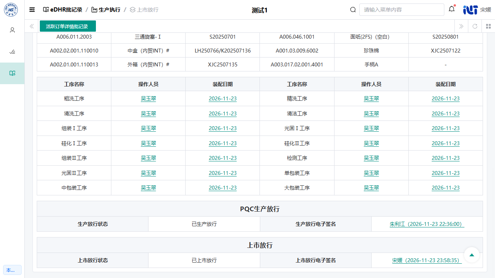

粗洗18200、生产损耗1、第4工序18200超181未分配、第2精洗次数0红值及检验首检损耗1均保留，未改回正常值绕开验证。损耗不作为不合格依据。

### 002：让步后最小接续

BHGSP-202611-00000029由管理员于11月23日21:42:01让步关闭。QA恢复后只核对已有处置、材料及任务完成，未重签。张飞红在原周期新增事件327247，10件、损耗0，11月24日00:09:50提交、00:21:15复核；原10件保留。结果交接2124861028173361152完成。

### 004：返工新周期接手

BHGSP-202611-00000030由管理员于11月23日21:47:02返工，签名66512。新周期1009200669正式关联旧周期1009200668及评审30，数量6016，生产检验重新起算。新增事件327248，10件、损耗0，11月24日00:28:51提交、00:33:16张飞红复核；交接2124862292168814592完成。未复用旧周期生产、检验签署。

两单仍显示生产检验0%，这是未完成整工序，不能据此否定新笔已提交复核；也不能把最小接续说成整单完成。

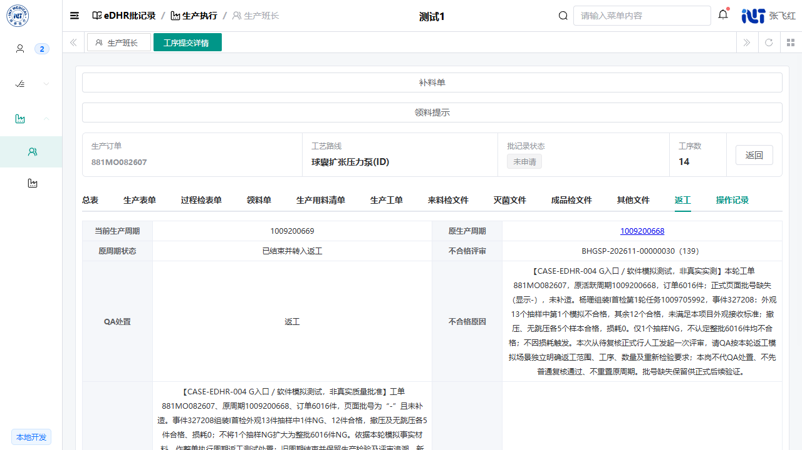
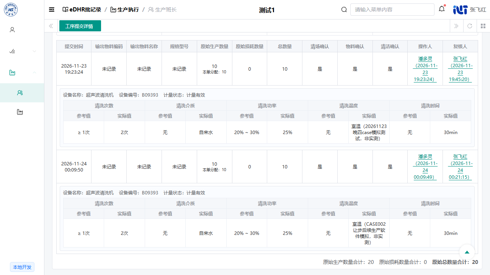
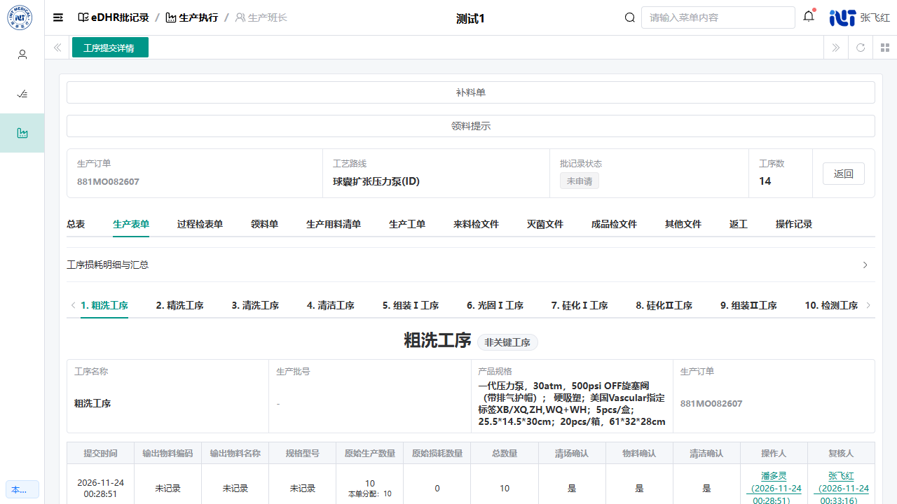

### 003：作废闭环

朱利江从申请352人工L入口于11月23日22:48:14发起BHGSP-202611-00000031，实际指定QA上官冰彦。QA上传模拟材料后于23:25:42作废，签名66519；评审关闭、批记录作废，QA任务2124877692151541760完成。

朱利江23:49—23:56查回申请352位于“已处理／已作废”，仅留详情，放行及重复审查入口移除，目标待放行为空。张飞红查回原周期作废，活跃池全页11条和完整订单筛选均未见该单或返工新周期；只读交接2124887124336902144完成。结论限当前本岗正式可见范围，不推断全部后台历史。

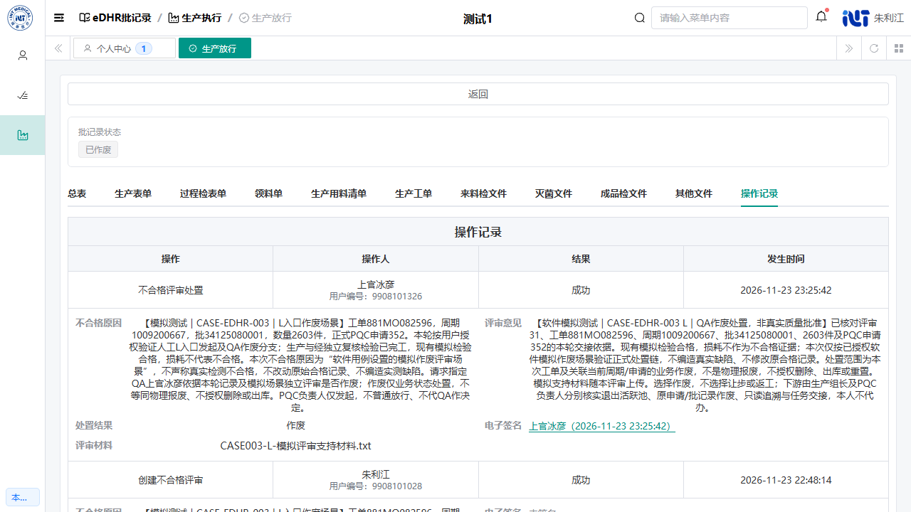
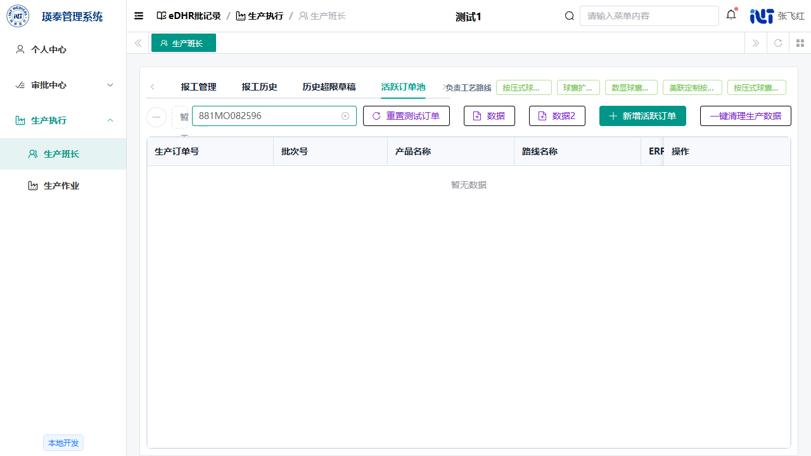

## 问题、恢复与证据边界

|编号／分类|实际发现及处理|结论／证据|
|---|---|---|
|01 协调错误|评审29、30选择管理员并派给管理员；这是我的协调分工错误，不以系统可选证明应由管理员承担。后续31改用正确QA。|保留真实历史，不重签掩盖，002／004不算正确QA岗位路径通过。见qa-shangguanbingyan/QA恢复后正式结果.md、截图03—05。|
|02 状态判断纠正|管理员工作被停止，早期处置结果列为未知；QA正式查询确认此前已有两项处置。|停止不等于未提交。已纠正，未重复办理。证据同上。|
|03 SOP技术错误|冻结工序缺少SOP文件绑定字段，关闭面板后可继续；002及004新周期仍见同类提示。|根因未修复。允许无SOP，不将单纯缺SOP当缺陷。001有原图，后两单只有报错原文记录，未另截当次图。|
|04 合法分配校验异常|327173报工6000、分配6000、剩余0却提示不得超过6000。保持生产6000、损耗1、总6001，重新确认后仅提交一次，20:13:32复核成功。|不重现不等于修复；原错误弹窗未截到，只有原值与未复核页及恢复图。production/004、005、008截图及327173复核恢复补充.md。|
|05 检验卡片异常|正式提交后提示缺少当前卡片正式数据。未重复提交，刷新查回40条记录恢复。|原因未知。inspection/004-提交后卡片缺少正式数据.png及刷新后结果。|
|06 批号缺失|004批号为“-”，新周期仍缺失，未补造。|本轮检验、评审、最小接续未被阻止，不推断后续要求可豁免。pqc-review/004-G批号缺失仍可提交.png及production/013截图。|
|07 入口观察|G／L发起页没有附件入口，材料当时只在本地准备；QA阶段已上传。原行仍有复核／审查入口。|准备不算上传；入口存在不足以证明可重复提交。003后续禁用及终态移除已查回。见pqc-review、pqc-release报告。|
|08 页面刷新行为|自动新建参数刷新重开空表单；QA详情内部切换后刷新曾返回31。|取消空表单，正常重新打开目标，无重复发起或串单提交，原因未定位。见PQC组长及QA报告。|
|09 状态短暂差异|QA23:25:42作废后，PQC约23:26仍评审中；23:49—23:56已查回作废。|当前不复现，不称根因修复。pqc-release/08及11—13截图。|
|10 跨单分配缺口|无匹配的已授权目标候选，取消草稿，未跨单生效。|未通过，不新增测试对象。production/003-跨单分配候选无匹配.png。|
|11 第8参数缺口|第8工序未找到明确范围，没有虚构异常值。|未覆盖；第2精洗红值保存及后续放行已覆盖。production/生产交接.md及006截图。|
|12 数量提示局限|第4工序18200原值保留，详情未见专门超量标识。|已证明未分配超量可完工上市，但活跃订单数量异常标识未充分验证；不因列表未提示认定全系统缺陷。production/009截图。|
|13 明细展示差异|PQC部分物料字段“未记录”与汇总领料显示不同，个别物料批号“-”。|仅记差异，未证明数据丢失，无专门截图。pqc-release/PQC本岗结果及问题.md。|
|14 环境阻塞|QA浏览器配置冲突、重启期间连接失败；按用户通知暂停，23:14已启动后恢复。|不列业务缺陷。配置冲突无页面截图，仅原错误文本；连接失败见pqc-release/07。|

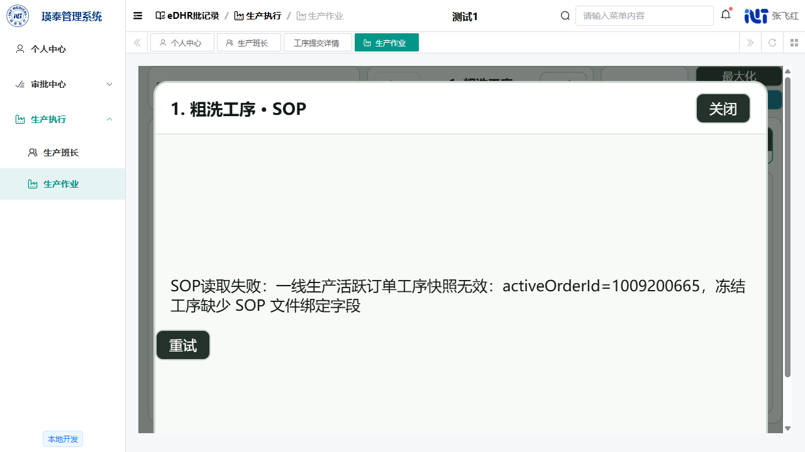
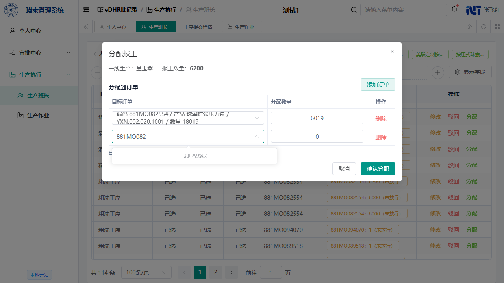
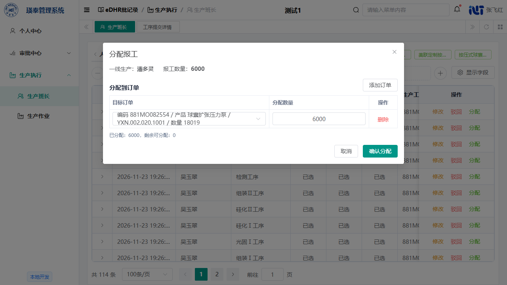
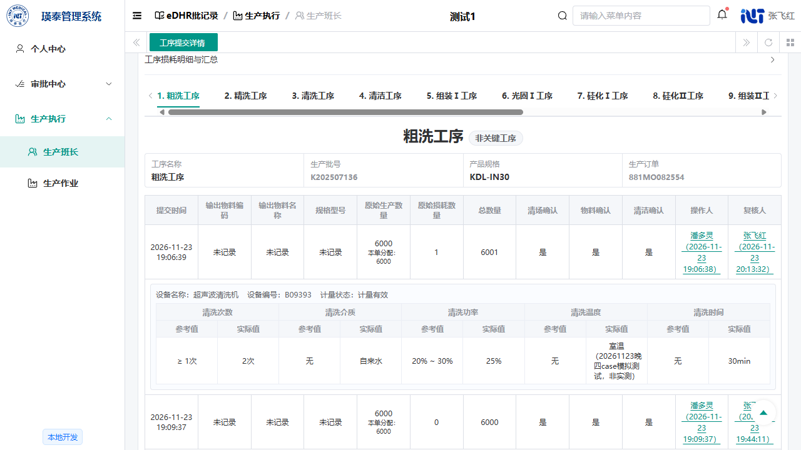
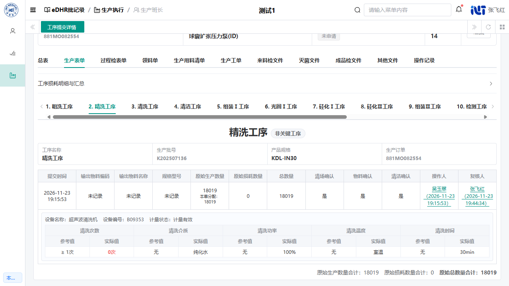
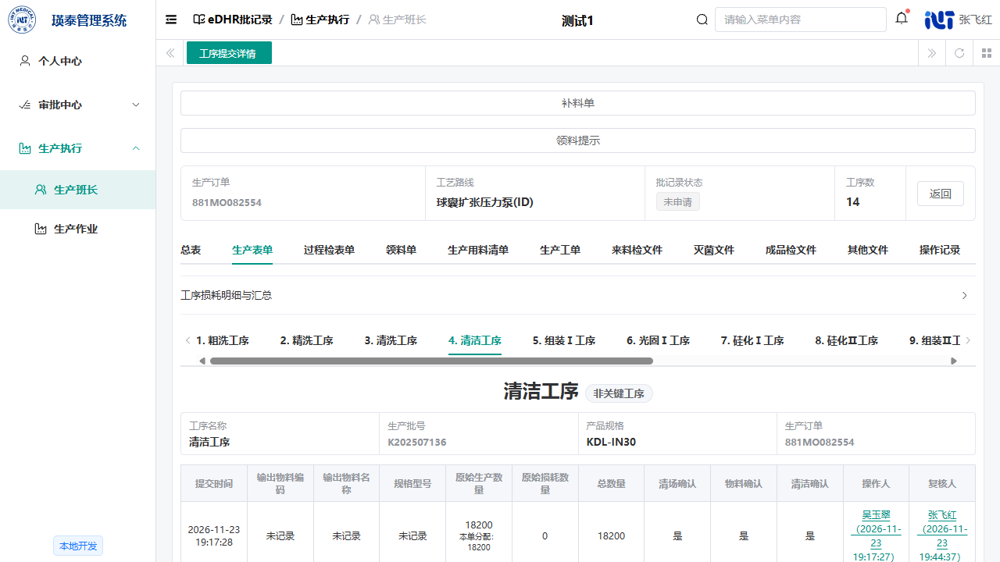
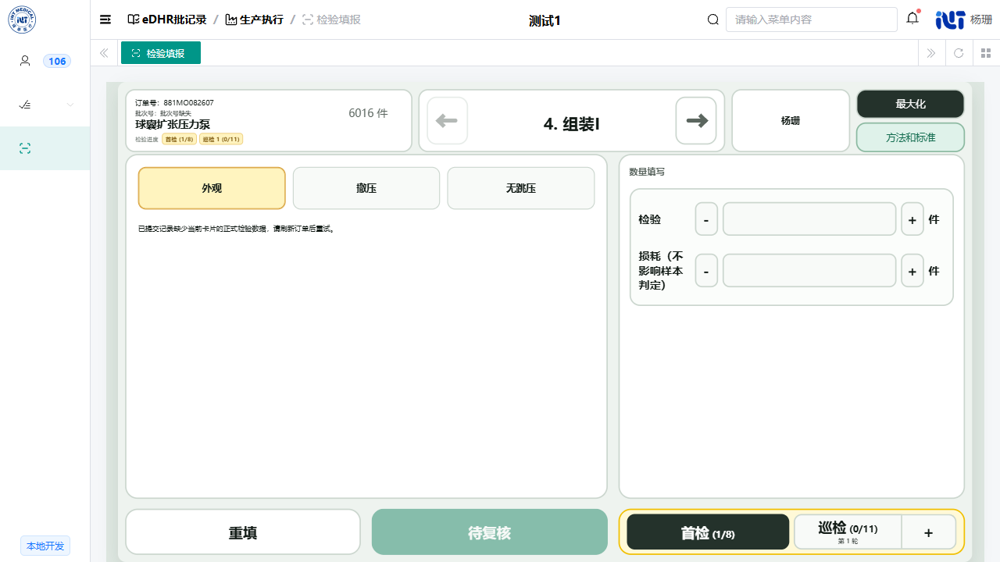

## 证据目录与收口

- production：初始生产、恢复、完工及002003004接续报告，截图001—020。
- inspection：40条检验交接及6张原图；pqc-review：38条正式历史清单、两G发起及9张原图。
- pqc-release：001生产放行、003发起、控制入口及终态补核；qa-shangguanbingyan：正式处置查询、003实际QA处置与环境记录。
- docs-incoming、docs-sterilization、docs-finished：四类模拟PDF、保存后刷新证据及岗位报告。
- market-release：001上市结果、正式回执、签名详情、历史与关闭记录。

保留旧证据，不删除或重置对象掩盖错误。没有补做无新疑点的已通过检查。已收口业务终点与未覆盖场景分开报告；不将002／004最小接续当整单上市，不将问题不复现当软件已修复，不将本轮单入口测试当两入口全覆盖。归档未执行。

